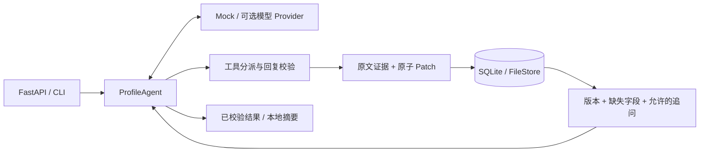

# Customer Profile Agent

**把对话中的客户需求，变成可追溯、可纠正、可持久化的结构化画像。**

这是从实际客户接待项目的 Function Calling Agent 核心整理出的**脱敏工程展示版**。重点是可靠的数据写入与多轮状态管理。新增了独立 FastAPI 入口、离线演示和 CI，便于在本机运行和查看代码。

所有示例均为虚构数据。原业务的品牌、客户会话、物流地点、费率、账号配置与平台集成不在此仓库中；这里使用通用产品询盘规则。

## 解决的问题

客户可能先说型号，下一轮补数量，再改口。仅靠聊天记录让模型生成一整份 JSON，容易覆盖旧需求、错配数量，或在保存失败时仍回复“已记录”。本项目把模型的建议与最终存储分开：

| 机制 | 实现与作用 |
| --- | --- |
| 原文证据 | 每项变更携带 `source_id` 与 `quote`，工具验证引用确实来自客户原文 |
| 增量更新 | 字段白名单与类型检查；整批 patch 校验通过后才写入，保留旧值审计 |
| 版本控制 | `expected_revision` + 存储事务，拒绝陈旧画像覆盖新版本 |
| 事件幂等 | 同一客户的 `message_id` 重试返回已保存结果；同 ID 不同正文拒绝执行 |
| 模型工具闭环 | `update_profile` → 读取持久化结果 → 单独 `finish_turn`，回复必须使用最新版本 |
| 追问约束 | 由当前缺失／歧义字段生成允许的 `question_id`，避免重复询问已确认字段 |
| 范围与修正 | 显式共享规格可继承；单项覆盖、数量歧义、取消产品保留审计记录 |
| 持久化与恢复 | 默认 SQLite；另提供带文件锁、`fsync` 和原子替换的文件存储实现 |

## 5 分钟运行

需要 Python 3.11+。以下演示无需模型账号、API Key 或外部服务。首次安装依赖需要联网；安装后 mock 演示和测试可离线运行。

```bash
git clone https://github.com/2328956238/customer-profile-agent.git
cd customer-profile-agent
python3 -m venv .venv
source .venv/bin/activate
python -m pip install -e '.[dev]'

# 运行三个固定的虚构对话，再重试同一事件
python -m customer_profile_agent.demo

# 启动本地 API
uvicorn customer_profile_agent.api:create_app --factory --host localhost --port 8000 --workers 1
```

浏览器打开 [交互式 API 文档](http://localhost:8000/docs)。默认数据保存至 `data/profiles.sqlite3`，该目录不会提交到 Git。

离线演示依次执行：

1. `我想了解 Device Alpha，128GB。` → 保存型号与容量，追问数量。
2. `先要 12 台，目的地是示例国 A，我有货代。` → 补齐询盘信息，生成本地摘要。
3. `数量改成 18 台。` → 更新为 18 台，审计记录仍能看到原来的 12 台。

最终画像为 `revision=6`：每轮事实 patch 一次、完成回复时状态保存一次。重试第三条消息返回原结果，版本保持 6。

**MockProvider 是固定场景脚本，不具备任意自然语言理解能力。** 它模拟模型的工具决策，执行真实的 Agent、校验器和存储代码。未知输入会明确提示使用示例句子，不猜测客户事实。

## API 示例

```bash
curl -s http://localhost:8000/profiles/demo-customer/turns \
  -H 'Content-Type: application/json' \
  -d '{"message_id":"m1","message":"我想了解 Device Alpha，128GB。"}'

curl -s http://localhost:8000/profiles/demo-customer/turns \
  -H 'Content-Type: application/json' \
  -d '{"message_id":"m2","message":"先要 12 台，目的地是示例国 A，我有货代。"}'

curl -s http://localhost:8000/profiles/demo-customer/turns \
  -H 'Content-Type: application/json' \
  -d '{"message_id":"m3","message":"数量改成 18 台。"}'

curl -s http://localhost:8000/profiles/demo-customer
```

重复发送完全相同的 `m3` 请求即可验证幂等。把 `m3` 的正文改成其他内容，接口返回 `409`。服务处理失败返回 `503` 与 `retryable=true`，不返回未经验证的客户回复。

一个事实的存储格式：

```json
{
  "value": 18,
  "status": "confirmed",
  "source_id": "m3",
  "quote": "18 台",
  "revision": 5
}
```

这里 `revision=5` 是该事实最后一次变更的版本；完成这一轮后的画像版本为 6。

## 架构



```text
src/customer_profile_agent/
├── agent.py          # 有步骤/时间上限的 Function Calling 闭环
├── profile_store.py  # 事实 patch、审计、SQLite CAS 与消息幂等
├── file_store.py     # Linux/macOS 文件锁与持久化替代方案
├── policy.py         # 通用虚构询盘规则，与模型/存储解耦
├── provider.py       # 可选的 Chat Completions 兼容传输
├── mock_provider.py  # 无网络固定演示场景
├── api.py            # 本地 FastAPI 接口
└── demo.py           # 自动演示与重复事件校验
tests/
├── test_core.py
└── test_api_and_stores.py
```

## 测试

```bash
python -m pytest
```

测试覆盖伪造引用拒绝、整批失败不改状态、字段类型校验、旧版本写入冲突、并发 CAS、重启后读取、客户隔离、事件重试、显式中断恢复、共享规格继承、歧义数量、工具参数修复、持久化故障、API 状态码等。离线流程测试会禁止 socket 连接；可选 Provider 的 HTTP 传输使用本地 `MockTransport` 验证，不调用真实模型。

GitHub Actions 在 Python 3.11 / 3.12 上运行测试与演示。演示版没有附带真实业务评测集，也不宣称模型准确率或生产吞吐量。

## 可选：接入模型

默认始终是 `mock`。手动设置 `PROFILE_MODE=live`，并配置 `.env.example` 中的 `PROFILE_BASE_URL`、`PROFILE_API_KEY`、`PROFILE_MODEL`，才会向你指定的 Chat Completions 兼容服务发送对话。程序只读取环境变量，不自动读取 `.env` 或其他项目的配置。

模型服务须支持 `tools` 与 `tool_choice=required`。不同服务的兼容性需实际验证，本仓库未执行真实模型调用。不要把真实客户数据用于公开演示，也不要将密钥写入代码。

## 范围与边界

- 这是实际项目核心的脱敏展示版，**不是完整客户接待平台**。没有真实消息渠道、CRM、权限系统、计费、价格查询或外部消息发送。
- `handoff` / `escalate` 仅返回本地摘要对象，`external_delivery` 始终为 `false`。示例不会安排运输、锁定库存或通知销售。
- 原文引用校验能够阻止虚构证据，但不能独立证明“字段值与引用含义完全一致”；模型语义质量仍需额外评测和人工审查。自然语言问句数量和报价拦截是局部模式检查，不能保证识别全部额外问题或虚构报价。
- 适合本机单进程演示。存储 CAS 能拒绝并发覆盖；它不等于分布式任务队列，也不保证同一客户的不同事件在多实例下按业务顺序执行。进程内客户锁暂未做容量淘汰。
- 事实 patch 与整轮完成分别持久化，未伪装成一笔跨模型调用的大事务。失败前已经落盘的事实会保留；完成事件的重试幂等，失败重试则基于已保存状态继续处理。
- 如果进程在事件处理中退出，该事件保持 `running`。确认原工作进程已停止后，可在运维代码中调用 `store.recover_turn(customer_id, message_id)` 再重试；不会按超时自动抢占仍可能存活的工作进程。
- API 未实现认证与访问控制，运行命令只监听本机；如需作为真实服务部署，需要补齐这些能力。文件存储依赖 `fcntl`，适用于 Linux/macOS。

### 代码来源与整理说明

`profile_store.py`、`file_store.py`、工具闭环及一部分单元测试整理自原客户接待项目对应模块。此版本保留通用的画像更新与存储逻辑，重写业务提示词和示例规则，删除品牌、真实地点、费率、旧配置回退及平台耦合。FastAPI、离线 Mock、演示入口、部分测试和 CI 为本次整理新增。

此仓库未附加开源许可证；公开展示不代表额外授予使用、分发或再授权许可。
