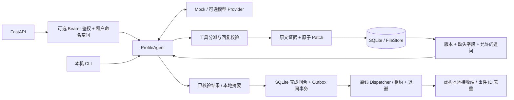

# Customer Profile Agent

**把对话中的客户需求，变成可追溯、可纠正、可持久化的结构化画像。**

这是从实际客户接待项目的 Function Calling Agent 核心整理出的**脱敏工程展示版**。重点是可靠的数据写入与多轮状态管理。新增了独立 FastAPI 入口、离线演示和 CI，便于在本机运行和查看代码。

所有示例均为虚构数据。原业务的品牌、客户会话、物流地点、费率、账号配置与平台集成不在此仓库中；这里使用通用产品询盘规则。

## 解决的问题

客户可能先说型号，下一轮补数量，再改口。仅靠聊天记录让模型生成一整份 JSON，容易覆盖旧需求、错配数量，或在保存失败时仍回复“已记录”。本项目把模型的建议与最终存储分开：

| 机制 | 实现与作用 |
| --- | --- |
| 原文证据 | 每项变更携带 `source_id` 与 `quote`，工具验证引用确实来自客户原文 |
| 增量更新 | 字段白名单与类型检查；整批 patch 校验通过后才写入，保留旧值审计 |
| 版本控制 | `expected_revision` + 存储事务，拒绝陈旧画像覆盖新版本 |
| 事件幂等 | 同一客户的 `message_id` 重试返回已保存结果；同 ID 不同正文拒绝执行 |
| 模型工具闭环 | `update_profile` → 读取持久化结果 → 单独 `finish_turn`，回复必须使用最新版本 |
| 追问约束 | 由当前缺失／歧义字段生成允许的 `question_id`，避免重复询问已确认字段 |
| 范围与修正 | 显式共享规格可继承；单项覆盖、数量歧义、取消产品保留审计记录 |
| 持久化与恢复 | 默认 SQLite；另提供带文件锁、`fsync` 和原子替换的文件存储实现 |
| 可选租户隔离 | 显式配置静态 Bearer 凭证后，API 按凭证确定租户；画像、历史、事件重放及进程内锁共用租户命名空间 |
| 本地交付闭环 | SQLite 同事务提交已完成回合与 Outbox 事件；离线 Dispatcher 演示租约领取、有限重试、确认 fencing 与虚构接收端去重（2026-10-14 展示版新增） |

## 5 分钟运行

需要 Python 3.11+。以下演示无需模型账号、API Key 或外部服务。首次安装依赖需要联网；安装后 mock 演示和测试可离线运行。

```bash
git clone https://github.com/2328956238/customer-profile-agent.git
cd customer-profile-agent
python3 -m venv .venv
source .venv/bin/activate
python -m pip install -e '.[dev]'

# 运行三个固定的虚构对话，再重试同一事件
python -m customer_profile_agent.demo

# 离线演示：摘要接收成功后退出，重启重发，相同事件只保存一份回执
python -m customer_profile_agent.outbox_demo

# 启动本地 API
uvicorn customer_profile_agent.api:create_app --factory --host localhost --port 8000 --workers 1
```

浏览器打开 [交互式 API 文档](http://localhost:8000/docs)。默认数据保存至 `data/profiles.sqlite3`，该目录不会提交到 Git。未设置 `PROFILE_AUTH_TOKENS` 时是**无认证的本机演示模式**，仅按上述命令监听 localhost；`/health` 会明确显示 `local-demo-unprotected`。

离线演示依次执行：

1. `我想了解 Device Alpha，128GB。` → 保存型号与容量，追问数量。
2. `先要 12 台，目的地是示例国 A，我有货代。` → 补齐询盘信息，生成本地摘要。
3. `数量改成 18 台。` → 更新为 18 台，审计记录仍能看到原来的 12 台。

最终画像为 `revision=6`：每轮事实 patch 一次、完成回复时状态保存一次。重试第三条消息返回原结果，版本保持 6。

**MockProvider 是固定场景脚本，不具备任意自然语言理解能力。** 它模拟模型的工具决策，执行真实的 Agent、校验器和存储代码。未知输入会明确提示使用示例句子，不猜测客户事实。

## API 示例

```bash
curl -s http://localhost:8000/profiles/demo-customer/turns \
  -H 'Content-Type: application/json' \
  -d '{"message_id":"m1","message":"我想了解 Device Alpha，128GB。"}'

curl -s http://localhost:8000/profiles/demo-customer/turns \
  -H 'Content-Type: application/json' \
  -d '{"message_id":"m2","message":"先要 12 台，目的地是示例国 A，我有货代。"}'

curl -s http://localhost:8000/profiles/demo-customer/turns \
  -H 'Content-Type: application/json' \
  -d '{"message_id":"m3","message":"数量改成 18 台。"}'

curl -s http://localhost:8000/profiles/demo-customer
```

重复发送完全相同的 `m3` 请求即可验证幂等。把 `m3` 的正文改成其他内容，接口返回 `409`。服务处理失败返回 `503` 与 `retryable=true`，不返回未经验证的客户回复。

一个事实的存储格式：

```json
{
  "value": 18,
  "status": "confirmed",
  "source_id": "m3",
  "quote": "18 台",
  "revision": 5
}
```

这里 `revision=5` 是该事实最后一次变更的版本；完成这一轮后的画像版本为 6。

## 可选：API 令牌与租户隔离

这是 **2026-10-07 新增的本地展示版增强**，不代表原业务已部署该权限方案。配置环境变量 `PROFILE_AUTH_TOKENS` 为 `{租户ID: 令牌}` 的 JSON 对象即可启用。也可在测试／嵌入应用中注入 `create_app(..., auth=ApiAuth({...}))`。租户只能由服务端配置的凭证确定，不接受客户端的 `tenant_id` 或 `X-Tenant-ID` 来选择身份。

以下示例在当前 shell 内随机生成一个演示凭证，值不会写入仓库。程序不自动加载 `.env`；其他终端发请求时也必须具备对应环境变量。

```bash
export PROFILE_DEMO_TOKEN="$(python -c 'import secrets; print(secrets.token_urlsafe(32))')"
export PROFILE_AUTH_TOKENS="$(python -c 'import json,os; print(json.dumps({"demo-shop":os.environ["PROFILE_DEMO_TOKEN"]}))')"
uvicorn customer_profile_agent.api:create_app --factory --host localhost --port 8000 --workers 1

# 在具备同一 PROFILE_DEMO_TOKEN 的终端请求（也可在 /docs 点击 Authorize）
curl -s http://localhost:8000/profiles/demo-customer \
  -H "Authorization: Bearer $PROFILE_DEMO_TOKEN"
```

- 所有 `/profiles/{customer_id}` 读取及 `/profiles/{customer_id}/turns` 写入都要求一个有效 Bearer 凭证；缺失、错误、其他认证方案或重复 Authorization 头均返回 `401`，附 `WWW-Authenticate: Bearer`。`/health` 和 API 文档公开，不返回租户或凭证。
- 用 JSON 数组编码 `(tenant_id, customer_id)` 后进行 URL-safe Base64 编码，避免直接拼接分隔符造成歧义。客户 ID、消息 ID 相同的不同租户各自读写和重放；伪造其他租户的内部存储键也仍会被重新加上当前租户命名空间。
- 令牌须为 32–256 个 URL-safe 字符，建议由 `secrets.token_urlsafe(32)` 生成。显式设置为空、JSON 格式错误、重复租户键、重复令牌等配置会使启动失败，不回退到无认证模式。鉴权对象仅保存令牌摘要，比较使用 `hmac.compare_digest`，凭证不传给模型或写入业务日志。
- 开启认证后使用新命名空间，不自动迁移原来无认证演示数据。凭证变更需重启；同一租户的令牌可访问该租户全部客户。CLI／直接存储调用属于本机可信操作，不经过 HTTP 鉴权。
- 这是小规模静态令牌鉴权，**没有 JWT、SSO、用户登录、RBAC、动态撤销或限流**；也不替代 TLS、部署配置及主机／数据库访问控制。跨主机传输 Bearer 凭证须使用 HTTPS。不要将默认无认证演示暴露到公网。

复现边界验证：`python -m pytest tests/test_api_auth.py`。这些测试在 SQLite 和文件存储上验证无效凭证、同客户／消息 ID 的跨租户读写与重放、冒用租户标记、内部键注入、并发命名空间和错误配置，全部使用临时凭证与虚构数据。

## 架构



```text
src/customer_profile_agent/
├── agent.py          # 有步骤/时间上限的 Function Calling 闭环
├── profile_store.py  # 事实 patch、审计、SQLite CAS 与消息幂等
├── file_store.py     # Linux/macOS 文件锁与持久化替代方案
├── policy.py         # 通用虚构询盘规则，与模型/存储解耦
├── provider.py       # 可选的 Chat Completions 兼容传输
├── mock_provider.py  # 无网络固定演示场景
├── api.py            # 本地 FastAPI 接口
├── auth.py           # 显式静态令牌配置、401 鉴权与租户命名空间
├── outbox.py         # SQLite 交付事件、租约 fencing、离线 Dispatcher 与虚构接收端
├── outbox_demo.py    # 接收后确认前退出、重启重复投递和幂等回执演示
└── demo.py           # 自动演示与重复事件校验
tests/
├── test_core.py
├── test_api_and_stores.py
├── test_api_auth.py
├── test_history.py
└── test_outbox.py
```

## 测试

```bash
python -m pytest
```

测试覆盖伪造引用拒绝、整批失败不改状态、字段类型校验、旧版本写入冲突、并发 CAS、重启后读取、客户隔离、事件重试、显式中断恢复、共享规格继承、歧义数量、工具参数修复、持久化故障、API 状态码等。离线流程测试会禁止 socket 连接；可选 Provider 的 HTTP 传输使用本地 `MockTransport` 验证，不调用真实模型。

2026-10-07 本地组合回归 **80 项通过**：24 项核心、11 项 API／存储、34 项鉴权、11 项历史读取测试。新增 SQLite 索引与限量读取只取最近 40 条消息；保留默认全量接口和两种存储原有的空回复语义。实现、同库合成基准条件、原始样本与限制见 [历史读取说明](docs/history-benchmark.md) 和 [基准结果 JSON](docs/history-benchmark-result.json)。这项增强未部署生产。

GitHub Actions 在 Python 3.11 / 3.12 上运行测试与演示。演示版没有附带真实业务评测集，也不宣称模型准确率或生产吞吐量。

## 2026-10-14 新增：离线 Transactional Outbox

SQLite 后端将经过校验的 `handoff` / `escalate` 回合结果与摘要事件放在同一事务提交。单独的离线 Dispatcher 领取事件，使用租约及领取 token 拒绝旧 worker 确认，并在失败后有限退避重试。虚构本地接收端按固定 `event_id` 保存一次摘要；演示“接收成功后、确认前退出”时，重启会重复投递，但接收端回执保持一份。

状态可通过 `GET /profiles/{customer_id}/deliveries` 或 `GET /profiles/{customer_id}/deliveries/{event_id}` 读取，沿用已有 Bearer 租户隔离。回合结果中的 `delivery.status` 是创建时快照；当前状态以状态接口为准。FileStore 保持旧的本地摘要行为，明确不提供 Outbox。

这是**脱敏展示版新增工程练习，未部署到原业务**；没有真实发送渠道或模型调用，`external_delivery` 仍为 `false`。它演示至少一次尝试和接收端幂等，不能保证外部 exactly-once；`dead` 也不代表接收端一定没收到。原子边界、重试配置、接口与故障验证见 [Transactional Outbox 说明](docs/transactional-outbox.md)。

2026-10-14 本地全量回归 **95 项通过**（原有 80 项 + Outbox 15 项），原离线示例和新增故障演示均通过。CI 配置已加入新演示命令；远端验证结果以对应提交的 GitHub Actions 记录为准。

## 可选：接入模型

默认始终是 `mock`。手动设置 `PROFILE_MODE=live`，并配置 `.env.example` 中的 `PROFILE_BASE_URL`、`PROFILE_API_KEY`、`PROFILE_MODEL`，才会向你指定的 Chat Completions 兼容服务发送对话。程序只读取环境变量，不自动读取 `.env` 或其他项目的配置。

模型服务须支持 `tools` 与 `tool_choice=required`。不同服务的兼容性需实际验证，本仓库未执行真实模型调用。不要把真实客户数据用于公开演示，也不要将密钥写入代码。

## 范围与边界

- 这是实际项目核心的脱敏展示版，**不是完整客户接待平台**。没有真实消息渠道、CRM、用户／角色权限管理、计费、价格查询或外部消息发送。
- `handoff` / `escalate` 返回本地摘要对象；SQLite 还保存可供离线 Dispatcher 处理的虚构交付事件，`external_delivery` 始终为 `false`。示例不会安排运输、锁定库存或通知销售。
- 原文引用校验能够阻止虚构证据，但不能独立证明“字段值与引用含义完全一致”；模型语义质量仍需额外评测和人工审查。自然语言问句数量和报价拦截是局部模式检查，不能保证识别全部额外问题或虚构报价。
- 适合本机单进程演示。存储 CAS 能拒绝并发覆盖；它不等于分布式任务队列，也不保证同一客户的不同事件在多实例下按业务顺序执行。进程内客户锁暂未做容量淘汰。
- 事实 patch 与整轮完成分别持久化，未伪装成一笔跨模型调用的大事务。失败前已经落盘的事实会保留；完成事件的重试幂等，失败重试则基于已保存状态继续处理。
- 如果进程在事件处理中退出，该事件保持 `running`。确认原工作进程已停止后，可在运维代码中调用 `store.recover_turn(customer_id, message_id)` 再重试；不会按超时自动抢占仍可能存活的工作进程。
- API 默认无认证、运行命令只监听本机；显式设置 `PROFILE_AUTH_TOKENS` 才启用上述静态令牌与租户隔离，尚未在生产部署验证。文件存储依赖 `fcntl`，适用于 Linux/macOS。

### 代码来源与整理说明

`profile_store.py`、`file_store.py`、工具闭环及一部分单元测试整理自原客户接待项目对应模块。此版本保留通用的画像更新与存储逻辑，重写业务提示词和示例规则，删除品牌、真实地点、费率、旧配置回退及平台耦合。FastAPI、离线 Mock、演示入口、部分测试和 CI 为本次整理新增。

此仓库未附加开源许可证；公开展示不代表额外授予使用、分发或再授权许可。
